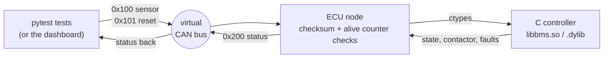

# bms-test-bench

[](https://github.com/aakashdoli/bms_test_bench/actions/workflows/ci.yml)

A software-in-the-loop test bench for a battery management system (BMS) controller.
The controller is written in embedded-style C, with no heap and all its state in one struct. It runs
on a virtual CAN bus, and automated pytest scripts drive it only through CAN frames,
the same way a verification rig drives a real ECU. Every test is linked to a safety
requirement, and a traceability report shows which tests prove each one. The bench injects
faults and corrupted or replayed messages, lets an AI model suggest missing edge cases
for a human to review, and runs in CI on every push.

## How it works



- **Fake clock:** time only moves when a test says so. There is no `sleep`, so the 45 tests run in under a second and always give the same result.
- **Only CAN:** tests never call the C code directly. They send frames and read the `0x200` status frame.

## Requirements

| ID | Requirement |
|---|---|
| REQ-01 | State is NORMAL when cell voltage is 3000 to 4200 mV and temperature is below 50°C. Contactor is closed. |
| REQ-02 | State is WARNING when temperature is 50 to 60°C. Contactor stays closed. |
| REQ-03 | Over-temperature fault when temperature is above 60°C. |
| REQ-04 | Under-voltage fault when voltage is below 3000 mV. |
| REQ-05 | Over-voltage fault when voltage is above 4200 mV. |
| REQ-06 | A fault only triggers after 3 bad readings in a row (debounce). A good reading resets the count. |
| REQ-07 | On any fault, open the contactor (cut power) in the same step. |
| REQ-08 | A fault stays latched until a reset command is received. |
| REQ-09 | Reset only works when the latest reading is normal. Otherwise it is ignored. |
| REQ-10 | Signal timeout: if no valid sensor frame arrives for 500 ms, go to fault. |
| REQ-11 | Frames with a wrong checksum are dropped and counted as bad readings. |
| REQ-12 | Frames with a repeated alive counter (replay or stuck sender) are dropped. |

The clarifications for edge cases (for example, whether 50°C is a warning) are in [requirements.md](requirements.md).

## CAN frames

**`0x100` sensor frame (8 bytes, tester → controller)**

| Byte | 0-1 | 2 | 3-5 | 6 | 7 |
|---|---|---|---|---|---|
| Content | voltage mV (uint16, big-endian) | temperature °C (int8) | zero | alive counter (0-255, wraps) | checksum = XOR of bytes 0-6 |

**`0x101` reset command:** byte 0 = `0xA5`.

**`0x200` status frame (4 bytes, controller → tester)**

| Byte | 0 | 1 | 2 | 3 |
|---|---|---|---|---|
| Content | state (0 NORMAL, 1 WARNING, 2 FAULT) | contactor (1 closed, 0 open) | fault bitmask | status counter |

Fault bitmask: bit 0 over-temperature, bit 1 under-voltage, bit 2 over-voltage, bit 3 timeout, bit 4 bad frames.

## How to run

Needs a C compiler (gcc or clang), `make` and Python 3.11.

```bash
python3.11 -m venv .venv && source .venv/bin/activate
pip install -e ".[test,dashboard,ai]"

make                              # build build/libbms.so (Linux) or .dylib (macOS)
make test                         # C unit tests with plain asserts
pytest                            # 45 tests over virtual CAN
python tools/trace_report.py      # reports/traceability.md and .html
streamlit run dashboard/app.py    # live dashboard in the browser

# Optional: AI test suggestions for human review
export GEMINI_API_KEY=<your key>
export GEMINI_MODEL=<a current Gemini model name>
python tools/ai_suggest.py        # writes reports/ai_suggestions.md, never tests/
```

## Results

- **C unit tests:** 34 checks, all passing
- **pytest:** 45 tests, all passing, in under 1 second
- **Traceability:** 12 of 12 requirements covered, 12 of 12 passing
- **Mutation check:** changing the debounce from 3 to 2 makes 8 tests fail, so the tests really guard REQ-06

An example report from a real run is in [reports/examples/traceability.md](reports/examples/traceability.md).

| What is tested | How |
|---|---|
| Boundaries | 49/50/60/61°C and 2999/3000/4200/4201 mV, as `parametrize` tables |
| Debounce | 2 bad readings do not fault, 3 do, and a good reading resets the count |
| Latch and reset | the fault stays on, reset is accepted when normal and ignored when not |
| Timeout | 499 ms is OK, 500 ms is a fault, and a 32-bit timer wrap is handled |
| Cybersecurity | bad checksum, wrong length, replayed counter, stuck sender, counter wrap 255→0 |

## Responsible AI

[tools/ai_suggest.py](tools/ai_suggest.py) asks an AI model for missing edge cases, linked to requirement IDs.

- The output is labelled **"AI suggestions: NOT REVIEWED. A human must review before adding any test."**
- Suggestions that point to a requirement ID that does not exist are flagged.
- The script can never write into `tests/`: every output path goes through a guard.
- In the dashboard, a person accepts or rejects each idea. Accepted ideas go to `reports/reviewed_suggestions.md` with the date. A human still writes the real test.
- With no API key, the script prints a friendly message and exits with code 0, so CI still passes.

## Screenshots

| | |
|---|---|
| Live control in FAULT state |  |
| Test runner results |  |
| Traceability |  |
| AI suggestions with human review |  |
| CI run |  |

## Project layout

```
requirements.md        safety requirements REQ-01 to REQ-12
firmware/              C controller (bms.h, bms.c) and C unit tests (test_bms.c)
bench/                 ctypes wrapper, CAN protocol, ECU node, fake clock
tests/                 pytest suite, grouped by topic, every test tagged with @pytest.mark.req
tools/                 traceability report and AI suggestions
dashboard/app.py       Streamlit live demo
reports/examples/      example reports from a real run
.github/workflows/     CI
```

## Limits

- This is **software-in-the-loop on a PC**, not real hardware or a real test rig. The C code runs on a laptop CPU, not a microcontroller, so timing, interrupts and memory limits are not tested.
- The CAN bus is virtual and runs inside one process. There are no bus errors, arbitration, bit timing or electrical faults.
- The XOR checksum and alive counter catch accidents and simple replays. They are not cryptographic, and a real attacker could forge them. Real vehicles add message authentication for that.
- The controller is a teaching model with one cell and one temperature. It has no state of charge, cell balancing or current measurement.
- **Next step:** hardware-in-the-loop. Flash the same C code onto a microcontroller board, connect it to a real CAN interface, and run the same pytest suite against it by swapping the virtual bus for a real one.
